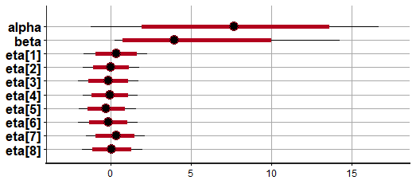
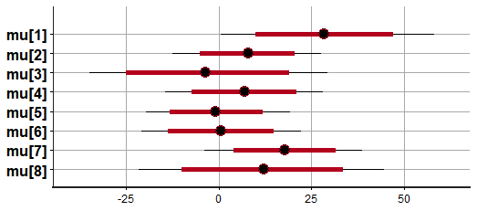
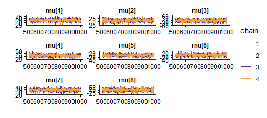

# Eight Schools: Hierarchical vs Non-Hierarchical Bayesian Models in Stan

A compact, reproducible comparison of **no pooling** and **partial pooling** (hierarchical)
Bayesian models on the classic *Eight Schools* data from Gelman et al., *Bayesian Data Analysis*,
Chapter 5. Models are written in [Stan](https://mc-stan.org/) and fit from R with `rstan`.

The central question: eight schools each report an estimated treatment effect with a large
standard error. How much should we believe each school's individual estimate, and does
borrowing strength across schools change the conclusions?

## Key findings

| | Raw data | No pooling | Partial pooling |
|---|---|---|---|
| School A posterior mean | 28.4 | 28.8 | **10.4** |
| School A 95% interval | n/a | 0.6 to 58.1 (excludes 0) | -1.3 to 27.2 (includes 0) |
| Spread of school means (max - min) | 31.8 | 31.8 | **4.4** |
| Average 95% interval width | n/a | 49.5 | **25.0** (about 49% narrower) |

- **No pooling just reproduces the data.** Posterior means sit within about 0.2 points of the raw
  estimates and posterior SDs match the raw standard errors. The model adds no information.
- **Partial pooling shrinks noisy extremes toward the overall mean.** School A falls from 28.8 to 10.4
  and its interval now includes 0. School C moves from -3.0 to +6.7.
- **Schools with the largest standard errors gain the most** from pooling (C and H: intervals
  narrow by 58% and 61%).
- **Population mean effect (alpha):** about 7.7, 95% interval -1.2 to 16.7. Probably positive,
  but not conclusive.
- **Between-school SD (beta):** median 4.0, 95% interval 0.2 to 14.3. Very uncertain with only
  eight schools.
- **Do not rank schools by posterior mean.** Intervals overlap heavily.
- Both models converged (Rhat <= 1.01; hierarchical Rhat 1.00 throughout; n_eff from 733 to 2,700).

Full tables, shrinkage statistics and a prior-sensitivity analysis are in
[`results/eight_schools_results.xlsx`](results/eight_schools_results.xlsx).

## Models

**No pooling** ([`stan/schools_no_pooling.stan`](stan/schools_no_pooling.stan)): each school has an
independent effect and a flat prior.

```
treatment[j] ~ Normal(mu[j], standard_error[j])
```

**Hierarchical, non-centered** ([`stan/schools_hierarchical.stan`](stan/schools_hierarchical.stan)):
school effects share a population distribution. The non-centered parameterization
(`mu = alpha + beta * eta`) avoids the funnel geometry that causes divergences and poor mixing
in the centered version.

```
alpha          ~ Normal(0, 20)        population mean effect
beta           ~ half-Cauchy(0, 5)    between-school SD (lower bound 0)
eta[j]         ~ Normal(0, 1)         standardized school offsets
mu[j]          = alpha + beta * eta[j]
treatment[j]   ~ Normal(mu[j], standard_error[j])
```

> **Note on the beta prior.** The results workbook was produced with
> `beta ~ half-normal(0, 10)`, while the Stan file in this repo currently uses
> `beta ~ cauchy(0, 5)` (half-Cauchy because of the lower bound). The prior-sensitivity sheet shows
> the substantive conclusions are stable across both (and half-normal(0, 5), half-Cauchy(0, 2.5)),
> but the exact numbers above come from the half-normal(0, 10) run. To reproduce them exactly, change
> that line in `stan/schools_hierarchical.stan` to `beta ~ normal(0, 10);`.

## Figures

| Hierarchical: alpha, beta, eta | No pooling: school effects (mu) |
|---|---|
|  |  |

Hierarchical trace plots of `mu` (4 chains, post-warmup), showing good mixing:



Intervals show 50% (thick) and 95% (thin) credible intervals.

## Repository structure

```
.
├── data/
│   └── schools.csv                  # school, effect, se (8 rows)
├── stan/
│   ├── schools_no_pooling.stan
│   └── schools_hierarchical.stan
├── R/
│   └── eight_schools.R              # fits both models, prints summaries and plots
├── results/
│   └── eight_schools_results.xlsx   # summaries, comparison, shrinkage, prior sensitivity
├── figures/
├── LICENSE
└── README.md
```

## Getting started

**Requirements:** R (>= 4.0), [`rstan`](https://mc-stan.org/rstan/) and a working C++ toolchain
(see the [RStan installation guide](https://github.com/stan-dev/rstan/wiki/RStan-Getting-Started)).
`shinystan` is optional for interactive diagnostics.

```r
install.packages("rstan")
install.packages("shinystan")   # optional
```

**Run** from the repository root:

```bash
Rscript R/eight_schools.R
```

Sampler settings: 4 chains, 1000 iterations, 500 warmup (2,000 post-warmup draws).

## Results workbook

`results/eight_schools_results.xlsx` contains:

| Sheet | Contents |
|---|---|
| Posterior Summary | Hierarchical model: mean, SD, quantiles, n_eff, Rhat, convergence checks |
| Non-Hier Summary | No-pooling model, same layout |
| Model Comparison | Side-by-side means, SDs and interval widths per school |
| School Shrinkage | Raw estimates vs posterior means |
| Prior Sensitivity | Effect of different priors on beta and mu (exact posterior via grid over beta, not Stan) |
| Interpretation | Plain-language reading of each result |
| Model & Notes | Model specification and assumptions |

## Data

Estimated coaching effects and standard errors for eight schools (Rubin, 1981; reproduced in
Gelman et al., *BDA*, Section 5.5).

| School | Effect | SE |
|---|---|---|
| A | 28.39 | 14.9 |
| B | 7.94 | 10.2 |
| C | -2.75 | 16.3 |
| D | 6.82 | 11.0 |
| E | -0.64 | 9.4 |
| F | 0.63 | 11.4 |
| G | 18.01 | 10.4 |
| H | 12.16 | 17.6 |

## References

- Gelman, A., Carlin, J. B., Stern, H. S., Dunson, D. B., Vehtari, A., & Rubin, D. B. (2013).
  *Bayesian Data Analysis* (3rd ed.), Chapter 5. CRC Press.
- Rubin, D. B. (1981). Estimation in parallel randomized experiments. *Journal of Educational
  Statistics*, 6(4), 377-401.
- Stan Development Team. [Stan User's Guide](https://mc-stan.org/docs/stan-users-guide/), on
  reparameterization of hierarchical models.

## License

MIT. See [LICENSE](LICENSE).
